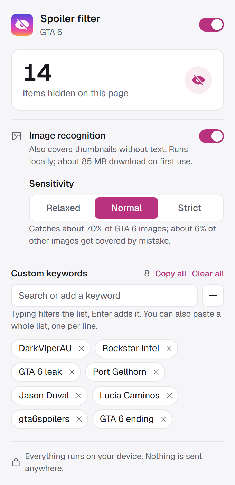

<div align="center">


# GTA 6 Spoiler Filter

**Browse the internet without GTA 6 spoilers.** A Brave / Chrome extension that blurs GTA 6 videos, posts, thumbnails and comments before you see them.

   

</div>

<br>

<picture>
  <source media="(prefers-color-scheme: dark)" srcset="docs/popup-dark.png">
  
</picture>

### What it does

**Reads the page.** One strong match like *GTA 6*, *Jason Duval* or *Port Gellhorn* hides the card. Weak words like *Vice City* or *Lucia* need a second one next to them, so old GTA content stays visible.

**Looks at the pictures.** A local CLIP model catches thumbnails that have no text at all.

**Stays out of the way.** Hidden items are greyed out and blurred. One click reveals a card without opening it. Hidden videos don't autoplay, and neither do hover previews.

**Learns your feed.** Add channel names, accounts or phrases. Paste a whole list at once, search it, export it.

**Keeps it private.** No server, no analytics, no account. The only download is the model, once.

<br clear="right">

## Install

```bash
git clone https://github.com/KantorIstvan/gta6filter.git
cd gta6filter
npm install        # copies the runtime into extension/vendor
```

1. Open `brave://extensions` (or `chrome://extensions`) and turn on **Developer mode**.
2. Click **Load unpacked** and pick the `extension` folder.
3. Pin it from the puzzle icon so the popup is one click away.

## How it decides

| Signal | How it works |
|---|---|
| **Text** | One strong hit (`GTA 6`, `GTA VI`, `#gta6`, `Grand Theft Auto VI`, `Jason Duval`, `Port Gellhorn`…) or two different weak ones (`GTA`, `Vice City`, `Jason`, `Lucia`, `Leonida`, `Rockstar`…) in the same card. Alt text counts too, Instagram often describes the image there. |
| **Images** | CLIP embeddings plus a small classifier trained on top. About 85 MB from Hugging Face on first use, cached after that. Only thumbnail-sized images near the viewport are checked. |
| **Sites** | Card-level rules for YouTube, Reddit, X, TikTok, Google and Facebook. Everywhere else it hides at `article` / `li` / paragraph level. |
| **Your keywords** | Case-insensitive substring match, each one counts as a strong hit. |

## Keyword lists

Your list lives in the popup. **Copy all** puts it on the clipboard, one keyword per line. Pasting a multi-line list into the keyword box adds every line and skips duplicates. Typing filters the list, so you can find one keyword and remove it with its ×.

<details>
<summary>My keyword list (copy and paste it into the popup)</summary>

Keywords are case-insensitive substring matches, so short ones like `Michael`, `Franklin` or `GTA V` also hide unrelated content. Remove what you don't need.

```text
GTA Series Videos
DarkViperAU
Broughy1322
GhillieMaster
MrBossFTW
Typical Gamer
GameRoll
TezFunz2
Tez2
Yan2295
videotech_
Rockstar Intel
RockstarIntel
Rockstar Mag
GTAForums
GTA Forums
GTABase
GTA BOOM
GTABOOM
GTA Wiki
gta.fandom
Rockstar Newswire
Rockstar Games
RockstarGames
Rockstar North
r/GTA
r/rockstar
Strauss Zelnick
Sam Houser
Dan Houser
Leonida
Vice City
Kalaga
Bae-Luxe
Only Raw Records
DreQuan
Dre'Quan
gtavitrailer
gtavileak
gtavigameplay
gtavinews
gta six
grand theft auto six
gta ⅵ
gtavi
Vice-Dale
Grassriver
Gellhorn
Tisha-Wocka
Allied Crystal
Jason Duval
Lucia Caminos
Cal Hampton
Boobie Ike
Dre Quan
Real Dimez
Raul Bautista
Raul Batista
Brian Heder
DWNPLY
Jack of Hearts
NINE1NINE
Brian's Boat Works
Rideout Customs
Electric Fang Tattoo
Diamond Dawgs
Hoodwinks
Zeke's Gadgets
Sandeep Plaza
Hobbs Milford
Sahara Arena
Stock 305
Megamundo
Sound 4 Sound
San 4 San
Vice Vinyl
Thrillbilly
High Rollerz
P.O.A.C.H.
Hamlet Neighborhood Watch
Misfire Games
Cocoteo
AfroBank
Chamber 106.6
Back Country Radio
Flash FM
Take-Two Interactive
GTA Online
Los Santos
Ammu-Nation
Pisswasser
Pißwasser
Logger Beer
Patriot Beer
Sprunk
Burger Shot
Cluckin' Bell
Cluckin Bell
Up-n-Atom
Weazel News
Lifeinvader
Bleeter
Lombank
Maze Bank
Fleeca
Pegassi
Übermacht
Ubermacht
Trevor Philips
Franklin Clinton
Michael De Santa
Lester Crest
Tommy Vercetti
GTA 6
GTA6
GTA VI
GTAⅥ
GTA-6
GTA-VI
GTA_6
GTA_VI
G.T.A. 6
GTAsix
GTA 6️⃣
Grand Theft Auto 6
Grand Theft Auto VI
Grand Theft Auto Ⅵ
GrandTheftAuto6
GrandTheftAutoVI
Grand Theft Auto VI: The Album
GTA VI The Album
GTA 6 The Album
An Extended Look
GTA 6 Extended Look
GTA Online 2
GTA VI Online
JasonDuval
LuciaCaminos
Jason and Lucia
Lucia and Jason
Jason & Lucia
Lucia & Jason
JasonAndLucia
LuciaAndJason
Jason és Lucia
Jason y Lucia
Jason et Lucia
Jason und Lucia
Jason e Lucia
CalHampton
BoobieIke
Dre'Quan Priest
DreQuan Priest
DreQuanPriest
RealDimez
Bae Luxe
BaeLuxe
RaulBautista
BrianHeder
OnlyRawRecords
Leonida Keys
LeonidaKeys
Leonida Penitentiary
Leonida Department of Corrections
State of Leonida
Grassrivers
Grass Rivers
Port Gellhorn
PortGellhorn
Mount Kalaga
MountKalaga
Kalaga National Park
Mount Kalaga National Park
Ambrosia Leonida
ViceCity
Vice City 2026
Vice Beach
Vice Beaches
Vice City Port
Vice City Keys
Vice City International
VCI Airport
Kelly County
Cocoteo FM
AfroBank FM
The Chamber 106.6
Delta Dawne
Mud Dog Mike
El Martillo y La Gata
Macacoa 2000
GTA 6 radio
GTA 6 soundtrack
GTA 6 album
GTA VI soundtrack
Palm & Flute
Palm and Flute
Righteous Slaughter Hood Ops
CyberLeek
$CYBERLEEK
Cyberleak
Cyber Leek
TeaPotUberHacker
Rockstar leak
Rockstar leaked
Rockstar hack
GTA 6 leak
GTA 6 leaked
GTA 6 leaks
GTA 6 leaked gameplay
GTA 6 map leak
GTA 6 hack
GTA VI leak
GTA VI leaks
GTA Base
The Gaming Gorilla
Madd Mike
Kiwi Talkz
Reece Reilly
Detective Seeds
The Ghost of Hope
GTA 6 Countdown
GTA6 Countdown
videotechuk
GTA 6 Info
GTA 6 News
GTA 6 Hub
GTA 6 spoiler
GTA 6 spoilers
GTA VI spoiler
GTA VI spoilers
GTA 6 ending
GTA 6 ending explained
GTA 6 final mission
GTA 6 last mission
GTA 6 story
GTA 6 story explained
GTA 6 full story
GTA 6 plot
GTA 6 lore
GTA 6 cutscene
GTA 6 cutscenes
GTA 6 all cutscenes
GTA 6 movie
GTA 6 walkthrough
GTA 6 playthrough
GTA 6 full game
GTA 6 mission
GTA 6 missions
GTA 6 first mission
GTA 6 first hour
GTA 6 prologue
GTA 6 chapter
GTA 6 part 1
GTA 6 episode 1
GTA 6 heist
GTA 6 heists
GTA 6 boss
GTA 6 gameplay
GTA 6 let's play
GTA 6 lets play
GTA 6 speedrun
GTA 6 100%
GTA 6 easter egg
GTA 6 easter eggs
GTA 6 secrets
GTA 6 theory
GTA 6 theories
GTA 6 review
GTA 6 reviews
GTA 6 reaction
GTA 6 stream
GTA 6 live
GTA 6 launch
GTA 6 launch trailer
GTA 6 trailer
GTA 6 trailer 3
GTA 6 map
GTA 6 characters
GTA 6 graphics
GTA 6 pre-order
GTA 6 preorder
GTA 6 price
GTA 6 PC
GTA 6 PS5
GTA 6 Xbox
GTA 6 memes
GTA 6 meme
GTA 6 funny moments
GTA 6 clip
GTA 6 clips
GTA 6 glitch
GTA 6 tips
GTA 6 guide
GTA 6 cheats
GTA 6 mods
GTA 6 magyarul
GTA 6 magyar
GTA 6 végigjátszás
GTA 6 végigjátszás magyarul
GTA 6 vége
GTA 6 befejezés
GTA 6 történet
GTA 6 sztori
GTA 6 küldetés
GTA 6 küldetések
GTA 6 megjelenés
GTA 6 kiszivárgott
GTA 6 kiszivárogtatás
GTA 6 spoiler magyar
GTA 6 teszt
GTA 6 előzetes
GTA 6 trailer magyarul
GTA 6 gameplay magyarul
GTA 6 első benyomás
GTA 6 élő
GTA 6 stream magyar
GTA 6 ár
GTA 6 gépigény
GTA 6 PC megjelenés
GTA 6 titkok
GTA 6 vicces
GTA 6 mémek
ГТА 6
ГТА6
ГТА VI
GTA 6 концовка
GTA 6 сюжет
GTA 6 прохождение
GTA 6 слив
GTA 6 final
GTA 6 final explicado
GTA 6 historia
GTA 6 misión
GTA 6 filtración
GTA 6 filtrado
GTA 6 español
GTA 6 história
GTA 6 vazou
GTA 6 vazamento
GTA 6 zerado
GTA 6 Ende
GTA 6 Handlung
GTA 6 Komplettlösung
GTA 6 deutsch
GTA 6 fin
GTA 6 histoire
GTA 6 fuite
GTA 6 français
GTA 6 finale
GTA 6 storia
GTA 6 italiano
GTA 6 zakończenie
GTA 6 fabuła
GTA 6 przejście
GTA 6 polska
GTA 6 sonu
GTA 6 hikaye
GTA 6 türkçe
GTA 6 sızıntı
GTA 6 Hindi
GTA 6 bahasa indonesia
GTA 6 tamat
グランド・セフト・オート6
グラセフ6
GTA6 実況
GTA6 ネタバレ
侠盗猎车手6
GTA6 剧透
GTA6 剧情
GTA6 스포
GTA6 스포일러
قراند 6
جي تي اي 6
gta6spoiler
gta6spoilers
gta6ending
gta6story
gta6leak
gta6leaks
gta6leaked
gta6gameplay
gta6trailer
gta6trailer3
gta6launchtrailer
gta6news
gta6update
gta6map
gta6memes
gta6meme
gta6clips
gta6edit
gta6edits
gta6shorts
gta6reels
gta6tiktok
gta6live
gta6stream
gta6reaction
gta6review
gta6walkthrough
gta6playthrough
gta6letsplay
gta6speedrun
gta6glitch
gta6tips
gta6guide
gta6mods
gta6cars
gta6characters
gta6graphics
gta6ps5
gta6xbox
gta6pc
gta6online
gta6release
gta6launch
gta6countdown
gta6hype
gta6fans
gta6community
gta6vicecity
gta6leonida
gta6jason
gta6lucia
gta6magyar
gta6magyarul
gta6hu
gtavispoilers
gtavileaks
gtaviedit
gta6easteregg
gta6secrets
gta6theory
gta6lore
gta6mission
gta6missions
gta6cutscene
gta6funny
gta6fanart
gta6album
gta6radio
gta6soundtrack
gta6extendedlook
gta6preorder
gta6price
Lucia death
Lucia dies
Lucia died
Lucia die
Lucia dead
Lucia is dead
is Lucia dead
does Lucia die
did Lucia die
death of Lucia
Lucia's death
Lucias death
Lucia killed
Lucia gets killed
Lucia murdered
kills Lucia
killed Lucia
Lucia kill
Lucia betrays
Lucia betrayal
Lucia betrayed
Lucia traitor
Lucia snitch
Lucia arrested
Lucia survives
Lucia alive
Lucia fate
Lucia funeral
RIP Lucia
Lucia RIP
Lucia ending
Lucia twist
Lucia villain
save Lucia
choose Lucia
Jason death
Jason dies
Jason died
Jason die
Jason dead
Jason is dead
is Jason dead
does Jason die
did Jason die
death of Jason
Jason's death
Jasons death
Jason killed
Jason gets killed
Jason murdered
kills Jason
killed Jason
Jason kill
Jason betrays
Jason betrayal
Jason betrayed
Jason traitor
Jason snitch
Jason arrested
Jason survives
Jason alive
Jason fate
Jason funeral
RIP Jason
Jason RIP
Jason ending
Jason twist
Jason villain
save Jason
choose Jason
Cal death
Cal dies
Cal died
Cal die
Cal dead
Cal is dead
is Cal dead
does Cal die
did Cal die
death of Cal
Cal's death
Cals death
Cal killed
Cal gets killed
Cal murdered
kills Cal
killed Cal
Cal kill
Cal betrays
Cal betrayal
Cal betrayed
Cal traitor
Cal snitch
Cal arrested
Cal survives
Cal alive
Cal fate
Cal funeral
RIP Cal
Cal RIP
Cal ending
Cal twist
Cal villain
save Cal
choose Cal
Boobie death
Boobie dies
Boobie died
Boobie die
Boobie dead
Boobie is dead
is Boobie dead
does Boobie die
did Boobie die
death of Boobie
Boobie's death
Boobies death
Boobie killed
Boobie gets killed
Boobie murdered
kills Boobie
killed Boobie
Boobie kill
Boobie betrays
Boobie betrayal
Boobie betrayed
Boobie traitor
Boobie snitch
Boobie arrested
Boobie survives
Boobie alive
Boobie fate
Boobie funeral
RIP Boobie
Boobie RIP
Boobie ending
Boobie twist
Boobie villain
save Boobie
choose Boobie
Dre'Quan death
Dre'Quan dies
Dre'Quan died
Dre'Quan die
Dre'Quan dead
Dre'Quan is dead
is Dre'Quan dead
does Dre'Quan die
did Dre'Quan die
death of Dre'Quan
Dre'Quan's death
Dre'Quans death
Dre'Quan killed
Dre'Quan gets killed
Dre'Quan murdered
kills Dre'Quan
killed Dre'Quan
Dre'Quan kill
Dre'Quan betrays
Dre'Quan betrayal
Dre'Quan betrayed
Dre'Quan traitor
Dre'Quan snitch
Dre'Quan arrested
Dre'Quan survives
Dre'Quan alive
Dre'Quan fate
Dre'Quan funeral
RIP Dre'Quan
Dre'Quan RIP
Dre'Quan ending
Dre'Quan twist
Dre'Quan villain
save Dre'Quan
choose Dre'Quan
DreQuan death
DreQuan dies
DreQuan died
DreQuan die
DreQuan dead
DreQuan is dead
is DreQuan dead
does DreQuan die
did DreQuan die
death of DreQuan
DreQuan's death
DreQuans death
DreQuan killed
DreQuan gets killed
DreQuan murdered
kills DreQuan
killed DreQuan
DreQuan kill
DreQuan betrays
DreQuan betrayal
DreQuan betrayed
DreQuan traitor
DreQuan snitch
DreQuan arrested
DreQuan survives
DreQuan alive
DreQuan fate
DreQuan funeral
RIP DreQuan
DreQuan RIP
DreQuan ending
DreQuan twist
DreQuan villain
save DreQuan
choose DreQuan
Raul death
Raul dies
Raul died
Raul die
Raul dead
Raul is dead
is Raul dead
does Raul die
did Raul die
death of Raul
Raul's death
Rauls death
Raul killed
Raul gets killed
Raul murdered
kills Raul
killed Raul
Raul kill
Raul betrays
Raul betrayal
Raul betrayed
Raul traitor
Raul snitch
Raul arrested
Raul survives
Raul alive
Raul fate
Raul funeral
RIP Raul
Raul RIP
Raul ending
Raul twist
Raul villain
save Raul
choose Raul
Brian death
Brian dies
Brian died
Brian die
Brian dead
Brian is dead
is Brian dead
does Brian die
did Brian die
death of Brian
Brian's death
Brians death
Brian killed
Brian gets killed
Brian murdered
kills Brian
killed Brian
Brian kill
Brian betrays
Brian betrayal
Brian betrayed
Brian traitor
Brian snitch
Brian arrested
Brian survives
Brian alive
Brian fate
Brian funeral
RIP Brian
Brian RIP
Brian ending
Brian twist
Brian villain
save Brian
choose Brian
Real Dimez death
Real Dimez dies
Real Dimez died
Real Dimez die
Real Dimez dead
Real Dimez is dead
is Real Dimez dead
does Real Dimez die
did Real Dimez die
death of Real Dimez
Real Dimez's death
Real Dimezs death
Real Dimez killed
Real Dimez gets killed
Real Dimez murdered
kills Real Dimez
killed Real Dimez
Real Dimez kill
Real Dimez betrays
Real Dimez betrayal
Real Dimez betrayed
Real Dimez traitor
Real Dimez snitch
Real Dimez arrested
Real Dimez survives
Real Dimez alive
Real Dimez fate
Real Dimez funeral
RIP Real Dimez
Real Dimez RIP
Real Dimez ending
Real Dimez twist
Real Dimez villain
save Real Dimez
choose Real Dimez
Bae-Luxe death
Bae-Luxe dies
Bae-Luxe died
Bae-Luxe die
Bae-Luxe dead
Bae-Luxe is dead
is Bae-Luxe dead
does Bae-Luxe die
did Bae-Luxe die
death of Bae-Luxe
Bae-Luxe's death
Bae-Luxes death
Bae-Luxe killed
Bae-Luxe gets killed
Bae-Luxe murdered
kills Bae-Luxe
killed Bae-Luxe
Bae-Luxe kill
Bae-Luxe betrays
Bae-Luxe betrayal
Bae-Luxe betrayed
Bae-Luxe traitor
Bae-Luxe snitch
Bae-Luxe arrested
Bae-Luxe survives
Bae-Luxe alive
Bae-Luxe fate
Bae-Luxe funeral
RIP Bae-Luxe
Bae-Luxe RIP
Bae-Luxe ending
Bae-Luxe twist
Bae-Luxe villain
save Bae-Luxe
choose Bae-Luxe
Roxy death
Roxy dies
Roxy died
Roxy die
Roxy dead
Roxy is dead
is Roxy dead
does Roxy die
did Roxy die
death of Roxy
Roxy's death
Roxys death
Roxy killed
Roxy gets killed
Roxy murdered
kills Roxy
killed Roxy
Roxy kill
Roxy betrays
Roxy betrayal
Roxy betrayed
Roxy traitor
Roxy snitch
Roxy arrested
Roxy survives
Roxy alive
Roxy fate
Roxy funeral
RIP Roxy
Roxy RIP
Roxy ending
Roxy twist
Roxy villain
save Roxy
choose Roxy
Jason or Lucia
Lucia or Jason
Jason vs Lucia
Lucia vs Jason
Jason and Lucia break up
Jason Lucia breakup
Lucia Jason breakup
Lucia leaves Jason
Jason leaves Lucia
Lucia meghal
Lucia meghalt
Lucia halála
Lucia halál
Lucia elárulja
Lucia árulás
Lucia áruló
Lucia túléli
Lucia sorsa
Lucia letartóztatás
Lucia börtönbe kerül
Lucia temetése
Lucia megöli
meghal Lucia
Lucia vége
Jason meghal
Jason meghalt
Jason halála
Jason halál
Jason elárulja
Jason árulás
Jason áruló
Jason túléli
Jason sorsa
Jason letartóztatás
Jason börtönbe kerül
Jason temetése
Jason megöli
meghal Jason
Jason vége
Cal meghal
Cal meghalt
Cal halála
Cal halál
Cal elárulja
Cal árulás
Cal áruló
Cal túléli
Cal sorsa
Cal letartóztatás
Cal börtönbe kerül
Cal temetése
Cal megöli
meghal Cal
Cal vége
Boobie meghal
Boobie meghalt
Boobie halála
Boobie halál
Boobie elárulja
Boobie árulás
Boobie áruló
Boobie túléli
Boobie sorsa
Boobie letartóztatás
Boobie börtönbe kerül
Boobie temetése
Boobie megöli
meghal Boobie
Boobie vége
Dre'Quan meghal
Dre'Quan meghalt
Dre'Quan halála
Dre'Quan halál
Dre'Quan elárulja
Dre'Quan árulás
Dre'Quan áruló
Dre'Quan túléli
Dre'Quan sorsa
Dre'Quan letartóztatás
Dre'Quan börtönbe kerül
Dre'Quan temetése
Dre'Quan megöli
meghal Dre'Quan
Dre'Quan vége
Raul meghal
Raul meghalt
Raul halála
Raul halál
Raul elárulja
Raul árulás
Raul áruló
Raul túléli
Raul sorsa
Raul letartóztatás
Raul börtönbe kerül
Raul temetése
Raul megöli
meghal Raul
Raul vége
Brian meghal
Brian meghalt
Brian halála
Brian halál
Brian elárulja
Brian árulás
Brian áruló
Brian túléli
Brian sorsa
Brian letartóztatás
Brian börtönbe kerül
Brian temetése
Brian megöli
meghal Brian
Brian vége
Real Dimez meghal
Real Dimez meghalt
Real Dimez halála
Real Dimez halál
Real Dimez elárulja
Real Dimez árulás
Real Dimez áruló
Real Dimez túléli
Real Dimez sorsa
Real Dimez letartóztatás
Real Dimez börtönbe kerül
Real Dimez temetése
Real Dimez megöli
meghal Real Dimez
Real Dimez vége
megölik Luciát
megöli Luciát
lelövik Luciát
elárulja Luciát
letartóztatják Luciát
megölik Jasont
megöli Jasont
lelövik Jasont
elárulja Jasont
letartóztatják Jasont
megölik Calt
megöli Calt
lelövik Calt
elárulja Calt
letartóztatják Calt
megölik Boobie-t
megöli Boobie-t
lelövik Boobie-t
elárulja Boobie-t
letartóztatják Boobie-t
megölik Rault
megöli Rault
lelövik Rault
elárulja Rault
letartóztatják Rault
megölik Briant
megöli Briant
lelövik Briant
elárulja Briant
letartóztatják Briant
Lucia muere
muerte de Lucia
Lucia traiciona
Lucia morre
morte de Lucia
Lucia trai
Lucia stirbt
Lucia Tod
Lucia tot
Lucia meurt
mort de Lucia
Lucia muore
morte di Lucia
Lucia umiera
Lucia ölüyor
Lucia öldü
Jason muere
muerte de Jason
Jason traiciona
Jason morre
morte de Jason
Jason trai
Jason stirbt
Jason Tod
Jason tot
Jason meurt
mort de Jason
Jason muore
morte di Jason
Jason umiera
Jason ölüyor
Jason öldü
Lucia muerta
Jason muerto
śmierć Lucii
śmierć Jasona
Люсия умирает
Лючия умирает
смерть Люсии
смерть Лючии
Джейсон умирает
смерть Джейсона
Hungarian Rockstar Club
HUROC
GTA V
Trevor
Franklin
Michael
Lamar
Lamar Davis
```

</details>

## Accuracy

> [!NOTE]
> At the default threshold (0.5), image recognition catches about **66%** of GTA 6 YouTube thumbnails and about **82%** of other GTA 6 images (posters, artwork, news cards), while flagging about **4%** of non-GTA images. False positives are mostly other open-world games and Miami / Florida photos. Text rules catch what the model misses.

> [!WARNING]
> **Known gaps**
> - On Instagram Reels only the caption is blurred, not the video.
> - The Reddit, X, Instagram and Facebook rules weren't tested live (bot protection or login). If something slips through, add a selector to the `SITE` list in `content.js`.
> - The model downscales to 224×224, so it can't read small captions or logos. If a site marks the topic only with a "GRAND THEFT AUTO VI" label in its own template (e.g. Hungarian Rockstar Club), add the site's name to your keywords.

## Development

```bash
npm test                      # self-check of the keyword rules
node tools/train-probe.mjs    # retrain extension/probe.json
```

`train-probe.mjs` pulls YouTube thumbnails and Bing images, embeds them with CLIP, fits a logistic regression and prints a cross-validation report per threshold and per source. If a topic keeps getting flagged, add a few such searches to its `neg` list and retrain.

The image recognizer logs to `brave://extensions`, then **Inspect views: offscreen.html** on the extension.
